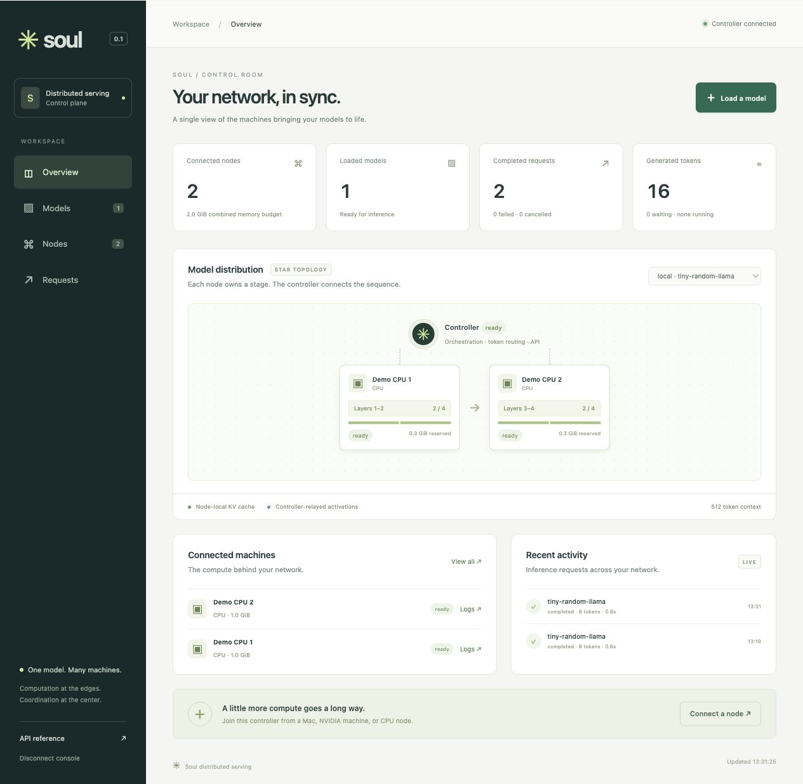

# Soul — distributed model serving

One model, many machines. Soul splits an LLM into contiguous decoder stages on a star network: nodes connect outward to a small controller, which accepts API requests and routes activations through the stages.

## Join the community

Contribute your machine's compute by running this command in a terminal:

```sh
curl -fsSL https://mastrogiovanni.ddns.net/soul/install.sh | bash
```

The installer detects **Apple Silicon macOS** or **Linux x86_64/ARM64**, selects CPU, Metal, or a compatible NVIDIA CUDA profile, and installs Python and the locked agent dependencies for your user. No Git checkout, existing Python installation, or `sudo` is needed. It immediately starts the agent and connects to **[the Soul community](https://mastrogiovanni.ddns.net/soul)** using the built-in enrollment token `your-node-enrollment-token`; there are no credentials to fill in.

**Keep the terminal open to contribute.** Press `Ctrl+C` to stop. Restart the installed agent with:

```sh
~/.local/share/soul/bin/soul-node
```

The agent uses your machine's memory and disk to serve assigned model layers. No inbound ports are needed. NVIDIA machines need a working driver; native Windows and Intel Macs are unsupported by this installer. See **[installation options, resource limits, updates, and troubleshooting](docs/install.md)**. To experiment locally instead, use the [local demo](#local-demo).

## About Soul

**This is an executable phase-1 inference implementation, not a training system.** It runs real transformer layers and node-local KV caches. The controller never loads model weights or imports PyTorch. The admin console is included, with no frontend build step.



## What works

- CPU-only FastAPI controller with OpenAI Chat Completions, text Completions, and Anthropic Messages endpoints; streaming and ordinary JSON responses.
- PyTorch nodes for NVIDIA CUDA, Apple Metal (`mps`), and CPU, with automatic device selection and persistent node identities.
- Automatic contiguous layer placement based on each node's estimates for weights, endpoint embeddings/head, KV cache, working memory, and its memory budget.
- Pinned Hugging Face revisions; HTTP range downloads of **only assigned tensors**, atomic local safetensors files, checksum validation, and reuse after restarts.
- Resident weights, or optional per-layer streaming from local disk to the GPU.
- Node-local rotary-position calculations, causal/sliding-window attention, and per-request KV caches. Chunked prefill bounds activation size.
- Explicit model preloading, persistent node cache inventories, and automatic repair of missing shards when nodes join, disconnect, or are removed.
- Bounded FIFO inference admission, GPU loading from prepared disk caches, generation fencing after reconnects, timeouts, and explicit failures.
- An admin UI for model placement, cached layers, offline-node removal, download progress, logs, queue state, request outcomes, and cumulative counters persisted in SQLite.
- `make up` deployment to the shared spesa-style Kind/Contour cluster, with HTTPS at `/soul`, persistent controller data and generated credentials.

**Model support is explicit:** unquantized safetensors checkpoints with Transformers `model_type` **`llama`, `mistral`, `qwen2`, or `qwen3`**, using their standard tensor layout. Examples include Llama-family models, SmolLM2, Qwen2.5, and Qwen3 dense models. A repository's `model_type` is authoritative, not its marketing name. MoE variants, Gemma, GPT-2, multimodal models, Mamba/hybrid models, custom remote code, GGUF, and prequantized checkpoints require additional adapters. Unsupported models fail clearly; Soul does **not** claim arbitrary Hugging Face compatibility.

## Local demo

Install [uv](https://docs.astral.sh/uv/getting-started/installation/) 0.9 or newer. From this checkout:

```sh
uv sync --locked --extra node
uv run --locked --extra node soul demo
```

Open **http://127.0.0.1:8000** and enter `soul-dev` as the admin key. The demo launches **three separate processes**: one controller and two CPU nodes. It builds a tiny four-layer Llama locally, distributes two layers to each node, and executes a request to populate the dashboard. No model download is required. The demo model has random weights, so its output is deliberately meaningless. Computation, communication, placement, and counters are real. `Ctrl+C` stops all three processes.

uv manages Python 3.12 (pinned in `.python-version`), the local `.venv`, and dependencies from `uv.lock`; no manual environment activation is needed. The `node` extra installs CPU PyTorch on Linux and the Metal-capable wheel on macOS. The demo always uses CPU.

If port 8000 is occupied, use `uv run --locked --extra node soul demo --port 8766`. Logs and reusable weights go in `.soul/demo/`. See [environment setup](docs/environment.md) for CUDA profiles, migration from an existing environment, and dependency updates.

## Run your own network

### Controller

The controller needs only the base package, not the node extra:

```sh
uv sync --locked

export SOUL_API_KEY='your-inference-key'
export SOUL_ADMIN_KEY='your-admin-key'
export SOUL_NODE_TOKEN='your-node-enrollment-token'
uv run --locked soul controller --host 0.0.0.0 --port 8000 --max-context 2048
```

Use independent, strong values for these three credentials. The API key can run inference; the admin key can inspect logs and load/unload models; the node token admits trusted compute nodes. `--dev` instead uses the public `soul-dev` credential and is restricted to loopback.

Native execution defaults to the dashboard at `/`, API documentation at `/docs`, and basic health at `/healthz`. Use `--context-root /soul` (or `CONTEXT_ROOT=/soul`) to serve the entire application beneath `/soul`; the container uses this prefix by default. Deployment state and counters live in `.soul/controller/controller.sqlite3`. Run **one controller process / one Uvicorn worker** against this state. Multi-controller consensus and shared scheduling are outside this release.

In the dashboard, open **Models → Use model** for a copyable curl request (streaming or JSON), the exact model ID and API base URL, and Open WebUI connection instructions. Enable **Site also requires HTTP Basic Auth** when using the shared ingress. Examples use your inference key (`SOUL_API_KEY`), never your admin key. The Ollama guide explains how to use Soul alongside Ollama in a compatible chat UI; Soul does not implement Ollama's native API.

For a remote network, use HTTPS/WSS through a reverse proxy or a private encrypted network. Nodes see prompts, activations, and portions of the model; enroll trusted machines only. Use `--allow-model owner/repository` repeatedly to restrict the model catalog. Administrators preload models; inference callers can use prepared models but cannot trigger downloads of arbitrary repositories.

### Kubernetes / shared HTTPS domain

With spesa's shared Kind/Contour platform and TLS already configured:

```sh
make up
```

The admin panel is exposed at **`https://<existing-domain>/soul/`**, sharing `ingress-root` and its certificate. First-run keys are saved in `.soul/kubernetes/credentials.env`; use its `SOUL_ADMIN_KEY` in the panel. Nodes connect to `https://<existing-domain>/soul`, and OpenAI clients use `https://<existing-domain>/soul/v1` as their base URL. `make down` removes only the application, retaining its data and credentials. See [Kubernetes deployment](docs/kubernetes.md) for platform paths, storage, Basic Auth, and commands.

### Mac node

On each machine, copy or clone this project and run:

```sh
uv sync --locked --extra node
export SOUL_NODE_TOKEN='your-node-enrollment-token'
uv run --locked --extra node soul node --controller https://controller.example.com --name mac-studio
```

The node uses CUDA if available, otherwise Metal, otherwise CPU. Metal uses the Mac's unified memory. `--device mps` requires a Metal-capable PyTorch installation; use `--device cpu` for a portable smoke test. No inbound node ports are required.

### NVIDIA node

On Linux, check the NVIDIA driver with `nvidia-smi`, then select **one** CUDA profile: `node-cu126`, `node-cu128`, or `node-cu129` for CUDA 12.6, 12.8, or 12.9. uv installs the corresponding official PyTorch **2.8.0** wheel and its runtime dependencies. For example, with a GPU and driver compatible with CUDA 12.8:

```sh
nvidia-smi
uv sync --locked --extra node-cu128
uv run --locked --extra node-cu128 python -c "import torch; print(torch.__version__, torch.version.cuda); assert torch.cuda.is_available(), 'CUDA is unavailable'; print(torch.cuda.get_device_name(0))"
export SOUL_NODE_TOKEN='your-node-enrollment-token'
uv run --locked --extra node-cu128 soul node --controller https://controller.example.com --device cuda:0 --name gpu-01
```

Use the same extra in every sync/run command; CUDA extras already include all node dependencies and must not be combined with `node` or each other. See [Linux CUDA setup](docs/environment.md#linux-with-nvidia-cuda) for driver checks and troubleshooting, and the [official PyTorch 2.8 builds](https://pytorch.org/get-started/previous-versions/#v280).

One process uses one device. For multiple GPUs on one host, run a node per GPU with a different `--cache-dir` and `--device cuda:N`; set explicit memory caps if resources are shared. Do not run Metal nodes inside Docker: use native macOS Python.

### Memory and disk controls

These examples use the CPU/Metal profile; replace `node` with your selected CUDA extra on NVIDIA hosts.

```sh
uv run --locked --extra node soul node --controller https://controller.example.com \
  --memory-gb 10 --weight-mode resident --cache-dir /fast-ssd/soul

# Keep only the executing decoder layer's weights on the GPU:
uv run --locked --extra node soul node --controller https://controller.example.com \
  --memory-gb 6 --weight-mode stream --cache-dir /fast-ssd/soul
```

A node initially budgets 75% of reported available device memory, capped by `--memory-gb`. Estimates include KV storage for one full context and allocator/workspace headroom. They are estimates, not hard memory isolation. External GPU use can still cause OOM; such a request fails and invalidates its deployment.

`resident` is the fast path. `stream` hydrates each local decoder layer from cached safetensors before executing it, then releases its parameters; edge embeddings/output head and KV caches remain resident. This supports shards larger than VRAM at the cost of substantial I/O and transfer latency. It is synchronous, without prefetch or overlap. KV offloading, paged attention, and quantization are not implemented. Downloaded tensors are retained after unload for reuse; there is no automatic disk quota/eviction yet.

Nodes persist identity in `<cache-dir>/identity.json`; reuse that directory after a restart. Never run two processes against the same node cache directory. Node logs rotate at 5 MiB with two backups. The dashboard shows the latest 300 controller-received lifecycle/error events per node in the current controller session.

## Load a model and generate text

Choose **Preload a model** in the admin UI, or call the preload endpoint before sending inference. Preloading downloads assigned tensors and the first stage's tokenizer to node disks, without taking GPU memory away from another model. Select **Preload and load GPU** if you also want to materialize the model before the first request. For gated/private models, authenticate **both controller and nodes** with `HF_TOKEN` or, after syncing the appropriate environment, `uv run --no-sync hf auth login`; tokens are not sent through the node protocol. Have sufficient local disk space and permission to use the model.

```sh
curl --fail-with-body http://localhost:8000/admin/models/preload \
  -H "Authorization: Bearer $SOUL_ADMIN_KEY" \
  -H 'Content-Type: application/json' \
  -d '{"model": "Qwen/Qwen2.5-0.5B-Instruct"}'

# Lists every executable cached model, including models not currently on a GPU
curl http://localhost:8000/v1/models -H "Authorization: Bearer $SOUL_API_KEY"
```

The preload call waits for its downloads; the dashboard displays progress concurrently. If capacity is insufficient, it returns `503` and retains the model as `partial` for later recovery. An unregistered inference model returns `404 model_not_preloaded`; an incomplete pipeline returns `503 model_not_ready`. Inference never downloads missing weights. It can still spend time loading prepared files into GPU memory.

```sh
curl http://localhost:8000/v1/chat/completions \
  -H "Authorization: Bearer $SOUL_API_KEY" \
  -H 'Content-Type: application/json' \
  -d '{
    "model": "Qwen/Qwen2.5-0.5B-Instruct",
    "messages": [{"role": "user", "content": "Explain pipeline parallelism in two sentences."}],
    "max_tokens": 80,
    "temperature": 0,
    "stream": true
  }'
```

OpenAI Python SDK:

```python
from openai import OpenAI

client = OpenAI(base_url="http://localhost:8000/v1", api_key="your-inference-key")
stream = client.chat.completions.create(
    model="Qwen/Qwen2.5-0.5B-Instruct",
    messages=[{"role": "user", "content": "Hello!"}],
    max_tokens=64,
    stream=True,
)
for chunk in stream:
    if chunk.choices:
        print(chunk.choices[0].delta.content or "", end="", flush=True)
```

Anthropic Python SDK:

```python
from anthropic import Anthropic

client = Anthropic(base_url="http://localhost:8000", api_key="your-inference-key")
with client.messages.stream(
    model="Qwen/Qwen2.5-0.5B-Instruct",
    max_tokens=64,
    messages=[{"role": "user", "content": "Hello!"}],
) as stream:
    for text in stream.text_stream:
        print(text, end="", flush=True)
```

These are protocol-compatible **local model** endpoints. They do not call OpenAI or Anthropic or provide proprietary models. See [API coverage](docs/api.md) for accepted fields and unsupported features.

## Scheduling and failure behavior

Phase 1 runs **one active generation across the cluster**, with up to 32 queued inference requests by default. This is deliberately conservative: it makes model replacement and exact KV cleanup tractable before adding continuous batching, replicas, and concurrent pipelines. It aggregates memory capacity; it does not promise lower single-request latency than one GPU.

The controller prefers reusing cached tensors, then fewer stages. It checks node memory and download disk-space estimates, accounts for the larger first/last stage weights, and allocates contiguous ranges. `--max-layers-per-node N` can force a smaller shard for experiments. Node compute-speed calibration and network-aware load balancing are future work.

Node reconnects invalidate every affected deployment and all old KV state. Later requests can rebuild the pipeline from disk-cached weights. In-flight requests fail; there is no transparent replay after output has been streamed. Before stream headers, failures use ordinary 4xx/5xx responses. During streaming, errors appear as protocol error events. A request must fit `prompt_tokens + max_tokens <= max_context`; the default is 2048, capped by the model's configured context.

Controller restarts preserve the model catalog, pinned metadata, counters and history but mark GPU placements stale; queued/running requests become failed. Nodes verify cached tensors and report their inventory when connecting, before any inference. The controller proactively prepares missing shards on connected nodes when a complete placement fits. It retains incomplete models in the admin inventory and omits them from `/v1/models` (also available as `/models`). Several models can remain executable on disk while only one occupies a node's GPU.

In **Nodes**, **Remove node** appears only for disconnected nodes. Removal forgets the controller's node record and schedules model repair on the remaining nodes; it does not erase the offline machine's files or revoke its enrollment token. The same identity can rejoin and report its cache again. Recovery respects memory, free disk, and `--max-layers-per-node`; use **Retry preload** after changing resources. Preload and repair share the inference scheduling lock, so large downloads can delay queued requests.

**Upgrade:** this cache-inventory protocol is version **2**. Restart the controller and all nodes with the updated code; version-1 nodes are rejected. Existing deployment records are migrated into the catalog and old tensor files are reused after inspection. Cache verification reads local files and can delay node registration for large caches. No prompt or generated text is saved in the controller's ledger.

## Development and verification

```sh
uv sync --locked --extra node --group dev
uv run --no-sync pytest -q
uv run --no-sync ruff check src tests examples
uv run --no-sync ruff format --check src tests examples

# Optional live download test: a small public checkpoint, no full-shard download
uv run --no-sync python examples/verify_hub.py
# Run the same exercise on an available accelerator
uv run --no-sync python examples/verify_hub.py --device mps
# On an NVIDIA host, select the matching CUDA profile first
uv sync --locked --extra node-cu128 --group dev
uv run --no-sync python examples/verify_hub.py --device cuda
```

Development tools and the two API SDKs are in the `dev` dependency group. `--no-sync` reuses the environment prepared by the preceding sync, including its selected PyTorch build. After changing dependencies or pulling an updated lockfile, sync again with the same profile. Do not use `--all-extras`: the node profiles are mutually exclusive.

Tests instantiate small random models locally. They compare sharded vs. unsplit logits for four architectures, chunked prefill, cached decode, sliding attention and disk streaming; run actual HTTP/WebSocket nodes with both official SDKs; and cover placement, auth, validation, reconnect fencing, cancellation cleanup and queueing. The Hub smoke test separately exercises actual remote tensor ranges and tokenizer loading.

The optional node runtime is intentionally pinned to Transformers **4.56.0** and PyTorch **2.8.0**, because model/cache internals are part of the stage adapter contract. Upgrade only together with equivalence tests. See [architecture](docs/architecture.md), [wire protocol](docs/protocol.md), and [phase 2](docs/phase-2.md).

## Repository

```text
src/soul/controller/   API adapters, scheduler, registry, SQLite ledger
src/soul/node/         device runtime, tensor cache, reconnecting client
src/soul/static/       admin console (HTML/CSS/JS; no CDN dependencies)
src/soul/catalog.py    pinned model metadata and strict range reader
src/soul/planner.py    contiguous placement planner
src/soul/protocol.py   MessagePack framing and protocol version
src/soul/demo.py       three-process, zero-download demo
install.sh            system-aware community agent installer (curl | bash)
examples/             optional real Hugging Face smoke test
tests/               numerical, protocol, and network integration tests
pyproject.toml       uv project, node profiles, development dependency group
uv.lock              reproducible dependency versions and package sources
.python-version      Python 3.12 for local environments and CI
```
