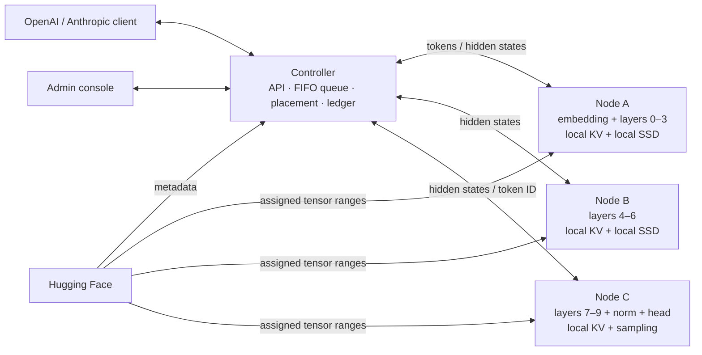

# Architecture and engineering decisions

## Scope

The described workload is autoregressive serving. There is no backward pass, gradient exchange, optimizer sharding, checkpoint writing, or distributed training in phase 1. Adding training would require a separate execution protocol and considerably different memory and failure semantics.

The architecture follows layer pipeline parallelism with a central relay. Nodes are not peers and never need each other's addresses.

## Responsibility split

| Concern | Owner | Reason |
| --- | --- | --- |
| API protocols, queue, placement, lifecycle | Controller | Global coordination |
| Model config / tensor shape discovery | Controller | Placement without full weights |
| Memory offer | Node | Device-specific cost/precision/streaming decisions |
| Download, disk cache, GPU residency | Node | Keep device and I/O policy at the edge |
| Tokenization / incremental detokenization | First node | Controller stays free of ML runtime dependencies |
| Embeddings | First stage | Feed the first decoder block locally |
| Rotary encoding, masks, attention, KV | Every stage | Same absolute positions; caches belong to the layers that use them |
| Final normalization, output head, sampling | Last stage | Return one token ID instead of a vocabulary-sized logits tensor |
| Stops, API output, request counters | Controller | Shared external semantics |

The controller relays **hidden activations**, not KV tensors. KV is neither the input embedding nor a reusable global embedding table: each decoder layer creates its own keys and values from its hidden input. Moving the entire cache centrally every token would multiply bandwidth and RAM costs unnecessarily.

## Model inspection and precise downloads

1. Resolve the repository revision to a commit SHA. Read config, generation config, and safetensors index.
2. Read only each shard's 8-byte header length and JSON tensor header using HTTP Range.
3. Record exact dtype, shape, shard filename, absolute offset, and byte length for each tensor.
4. Ask eligible nodes for their cost matrices, choose contiguous ranges, then send immutable assignment metadata.
5. Nodes fetch only tensor bytes belonging to their assigned range, plus edge tensors where needed. Tied embeddings are copied to both edge nodes when those edges live on separate devices.
6. Write each tensor as an atomic, valid safetensors file. Check local SHA-256 on cache reuse and repair incomplete/corrupt files. This checksum detects local cache corruption; upstream identity comes from the pinned commit, validated ranges and HTTPS, not an independently verified per-tensor Hub checksum.

Range requests must return an exact `206 Content-Range`; the reader refuses a server that ignores ranges. Checkpoint downloads do not execute pickle or remote model code. The controller's regular Hugging Face cache contains only small metadata files; the first node additionally downloads tokenizer resources.

## Stage adapter

The current adapter targets the shared `model.embed_tokens`, `model.layers`, `model.norm`, `lm_head` topology of standard Llama, Mistral, Qwen2 and Qwen3 dense models. It constructs a metadata-only model on PyTorch's `meta` device, removes unassigned layers and edge modules, and materializes only assigned parameters. Local layer indices and cache configuration are remapped while the original position/rotary configuration is preserved. First-stage embeddings and final-stage normalization/head run exactly once.

Every new architecture needs more than a class name in the allowlist: verify scaling at the embedding boundary, residual state, extra conditioning inputs, sliding/linear attention, cache layout, tensor names, and tied parameters. Extend the adapter and add full-vs-sharded prefill/decode equivalence tests. Tensor-parallel collectives and expert routing are different decomposition strategies.

## Autoregressive execution

Tokenize on the first stage, validate context, prefill in chunks of at most 128 tokens, then decode one token per pipeline traversal. Each chunk carries the same session ID, deployment epoch and absolute token position through all stages. A node checks the expected next position before touching its cache. A stage forwards a contiguous `[1, tokens, hidden_size]` tensor. The final node samples only the last position. Additional prefill chunks do not sample tokens.

The sampled ID returns to the controller. The first node decodes the accumulated output with tokenization cleanup disabled; the controller withholds incomplete UTF-8 and potential stop-string prefixes. Stop text is excluded from output. End-of-sequence IDs come from `generation_config.json` when present. Models without a chat template receive a documented, simple `role: content` transcript rather than an invented model-specific template.

Phase 1 has one global FIFO generation lock. Streaming, queue wait, and node operation deadlines are distinct. The node wire reader executes RPCs in order, while a separate heartbeat task remains responsive and GPU/loading calls run in a worker thread. Cancellation sends release behind any already-running forward call. An AnyIO cancellation shield holds the scheduling lock until cleanup completes or a node is fenced by timeout.

## Memory and placement

For each candidate contiguous range, a node estimates:

`1.10 × resident_weight_bytes + layers × KV_per_layer + workspace`

`KV_per_layer = 2 × kv_heads × head_dim × max_context × element_size`

`resident_weight_bytes` is the sum of that range's layer weights in resident mode, or the largest layer in stream mode, plus embeddings/head/norm as applicable. Workspace accounts for chunked attention, MLP temporaries, and a minimum 256 MiB reserve. Sliding-window KV is conservatively charged as a full context.

The planner sorts nodes by budget and uses dynamic programming across contiguous intervals, permitting skipped nodes and minimizing stage count within that fixed order. It does not optimize all node permutations: an unusual asymmetry in first/last-stage costs may require adjusting node budgets/order or a future permutation-aware planner. Raw byte estimates cannot perfectly predict allocator fragmentation, concurrent external workloads or backend kernels. OOM is an explicit failed request, never silently approximated computation.

Disk streaming transfers one decoder layer per stage forward pass; it does not stream the edge head or embeddings. There is no asynchronous prefetch or overlap yet. GPU-resident KV can therefore still be the limiting factor. Weight streaming is a capacity feature, often significantly slower than resident inference.

## Failure and state

A connection has a new generation UUID; a placement has its own epoch. Replacing a node connection invalidates earlier assignments. Nodes clear GPU state on reconnect before consuming new RPCs. The controller only uses deployments whose recorded connection generations still match. It never assumes an old cache survived a crash.

SQLite stores node records, deployment history and request outcomes, but all recovered deployments start stale. Work queued/running at a controller crash becomes failed. After startup, nodes reconnect and the next inference can replan/reload using their disk caches. The system does not resume partial generations. Streaming failures are sent as error events; pre-stream failures return 5xx. Node heartbeat expiry is 30 seconds and heartbeats run every 5 seconds.

## Controller sizing and performance

No GPU, weights, vocabulary logits, or KV caches are required on the controller. Its model metadata is proportional to tensor count, and its activation working set is bounded by 64 MiB RPC frames and a 128-token prefill chunk. A small ARM Linux machine can run the base package if its Python dependencies have suitable wheels. Hardware-specific throughput and RAM consumption must still be measured.

For `S` stages, hidden size `H`, activation precision `B` bytes, relay traffic is approximately `2 × (S − 1) × H × B` bytes per decoded token, plus control and detokenization messages. Prefill multiplies this by prompt length. Every boundary adds two network traversals; every decoded token also makes a detokenization RPC. A Raspberry Pi controller may be network-bound well before memory-bound. This design prioritizes combining memory capacity and installation simplicity over latency.

## Trust boundary

Use authenticated, trusted nodes and encrypted transport outside loopback. Roles use separate tokens. The node protocol uses bounded MessagePack, never pickle. The controller does not forward its Hugging Face credential to nodes. APIs reject unsupported fields and non-text input instead of silently ignoring them. There is no sandbox for a malicious authenticated node: it could return wrong activations, inspect requests or impersonate another node. Public volunteer compute requires attestation/isolation, per-node identity credentials and verification beyond this release.

## Primary references

- [Hugging Face safetensors range/metadata format](https://huggingface.co/docs/safetensors/metadata_parsing)
- [Transformers KV cache strategies](https://huggingface.co/docs/transformers/v4.56.0/en/kv_cache)
- [PyTorch Metal backend](https://docs.pytorch.org/docs/stable/notes/mps.html)
- [OpenAI streaming response schema](https://developers.openai.com/api/reference/resources/chat/subresources/completions/streaming-events)
- [Anthropic Messages streaming event order](https://platform.claude.com/docs/en/build-with-claude/streaming)
